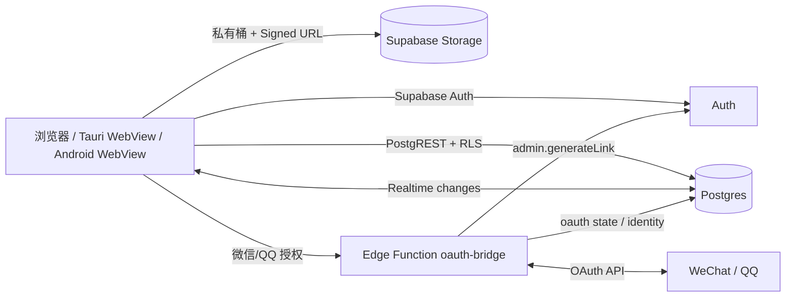

# 知隙 · 经济学考研云端错题本

> 面向顶尖 985 经济学考研的错题本。保留原单文件版本的完整 UI 与业务逻辑，在其上叠加 Supabase 登录、云端同步、图片对象存储，以及 Tauri / Capacitor 打包能力。

- **前端**：Vite + Tailwind CSS（编译版）+ 原生 JavaScript（无 UI 框架）
- **后端**：Supabase Auth / Postgres / Row Level Security / Storage / Realtime / Edge Functions
- **公式**：MathJax 3（CDN 动态加载，含多 CDN 回退）
- **本地 OCR**：Tesseract.js（CDN 动态加载，图片只在浏览器内识别，不发送给第三方 OCR 服务）
- **官方载体**：静态网站 / Tauri 2（Windows、macOS）/ Capacitor 7（Android）

---

## 1. 功能

### 原有功能全部保留

1. 拍照 / 相册上传图片，浏览器内 Tesseract OCR 自动填题干；图片先压缩，支持识别后手动校对公式和文字。
2. MathJax 支持 `$...$` 行内公式和 `$$...$$` 独立公式。
3. 错题编辑：题干、参考答案、错因分析、图片、标签、掌握程度（未掌握 / 一般 / 已掌握）。
4. 六个内置标签：微观经济学、宏观经济学、计量经济学、政治经济学、数三、英语；支持自定义标签。
5. 艾宾浩斯复习：按掌握等级生成下次复习日期，页面内到期提醒，可请求系统通知。
6. 刷题：按标签筛选、随机抽题、5 / 10 / 20 / 全部题量、结束自动统计正确率。
7. JSON 导入导出：合并导入、覆盖导入。原生 App 里会调用系统保存 / 分享面板。
8. 移动端优先响应式布局，手机 / 平板 / 电脑触控可用。

### 新增云端能力

- 手机号验证码登录（Supabase Auth Phone OTP）。
- 微信、QQ 授权登录（自建 Supabase Edge Function 桥接，因为两者不是标准 OIDC Provider）。
- 每个用户的数据完全隔离：所有业务表启用 RLS，图片 Storage 桶为私有桶，路径按 `auth.uid()` 隔离。
- 错题文本、复习记录、标签、提醒设置同步到 Postgres；图片上传至 Supabase Storage。
- 多设备同步：Supabase Realtime + 前台兜底同步 + 线上/离线自动重试。
- 每台设备保留按用户区分的本地缓存：断网时仍可查看、录入，恢复网络后补同步。
- 支持导入旧版单文件知隙的本地数据：设置页「导入本机旧数据」。迁移成功后会移除旧版 localStorage key 以释放配额；导入前建议在旧版导出备份。
- 原生壳中的 JSON 备份导出：Tauri 使用保存对话框 + Rust 写文件；Android 使用 Filesystem + Share 系统面板。

---

## 2. 目录结构

```text
zhixi-cloud/
├── index.html                              # SPA 入口 + 登录门禁根节点 + 原应用壳
├── package.json
├── pnpm-lock.yaml
├── pnpm-workspace.yaml                     # pnpm 构建脚本白名单
├── vite.config.js
├── tailwind.config.js
├── postcss.config.js
├── capacitor.config.ts                     # Android / Capacitor 配置
├── .env.example
├── .gitignore
├── README.md
│
├── public/
│   └── _redirects                          # Netlify SPA fallback
│
├── resources/
│   ├── icon.png                            # Capacitor Assets 使用的 1024 图标
│   └── splash.png                          # Capacitor 启动图源文件
│
├── scripts/
│   └── patch-android-manifest.mjs          # cap add android 后补 custom scheme
│
├── src/
│   ├── main.js                             # 登录门禁、Auth/Sync 启动编排、MathJax 配置
│   ├── app/
│   │   └── app.js                          # 原错题本完整业务/UI，仅叠加 cloud hooks
│   ├── auth/
│   │   ├── auth-service.js                 # 手机 OTP、Deep Link、OAuth 入口封装
│   │   └── auth-ui.js                      # 登录 / 同步中 / 配置错误界面
│   ├── cloud/
│   │   ├── cloud-sync.js                   # 云端读取、合并、上传图片、软删除、Realtime
│   │   └── cloud-ui.js                     # 设置页账号卡、手动同步、旧数据迁移
│   ├── lib/
│   │   ├── supabase.js                     # Supabase client + 环境变量
│   │   └── platform.js                     # Web / Tauri / Capacitor 能力适配
│   └── styles/
│       ├── legacy.css                      # 原版本样式，不改动
│       ├── tailwind.css                    # @tailwind base/components/utilities
│       └── cloud.css                       # 登录门禁、同步卡等新增样式
│
├── supabase/
│   ├── config.toml
│   ├── .env.functions.example
│   ├── migrations/
│   │   └── 20261112000000_init.sql         # 建表 / RLS / Storage / Realtime
│   └── functions/
│       └── oauth-bridge/
│           └── index.ts                    # 微信/QQ OAuth 桥接 + Supabase magiclink token
│
├── src-tauri/
│   ├── Cargo.toml
│   ├── build.rs
│   ├── tauri.conf.json
│   ├── capabilities/default.json
│   ├── app-icon.png
│   ├── icons/...                           # 已生成的 Windows/macOS/Linux/iOS/Android 图标
│   └── src/main.rs
│
└── docs/
    ├── SUPABASE_SETUP.md
    ├── OAUTH_WECHAT_QQ.md
    ├── DEPLOYMENT.md
    ├── TAURI.md
    ├── CAPACITOR.md
    └── TROUBLESHOOTING.md
```

---

## 3. 快速开始（Web）

### 3.1 准备环境

- Node.js >= 20
- pnpm >= 9（npm 也可以，命令自行替换）
- 一个 Supabase 项目（免费计划即可开始）

```bash
cd zhixi-cloud
pnpm install
```

### 3.2 配置 Supabase

按文档执行：

1. [Supabase 初始化](docs/SUPABASE_SETUP.md)
   - 执行 `supabase/migrations/20261112000000_init.sql`
   - 开启 Phone Provider / 短信服务
   - 配置 Auth Redirect URLs
   - 部署 `oauth-bridge` Edge Function
   - 设置存储桶与 RLS（SQL 已包含）
   - 开启 Realtime
2. 微信 / QQ 开放平台申请与回调域名配置：[OAUTH_WECHAT_QQ.md](docs/OAUTH_WECHAT_QQ.md)

### 3.3 前端环境变量

```bash
cp .env.example .env
```

填写：

```dotenv
VITE_SUPABASE_URL=https://YOUR_PROJECT_REF.supabase.co
VITE_SUPABASE_ANON_KEY=YOUR_ANON_KEY

VITE_OAUTH_BRIDGE_BASE_URL=https://api.your-domain.com/functions/v1/oauth-bridge
VITE_APP_URL=https://your-domain.com
VITE_NATIVE_DEEP_LINK=zhixi://auth/callback
```

> `VITE_OAUTH_BRIDGE_BASE_URL` 必须与 Edge Function 的 `OAUTH_CALLBACK_BASE_URL` 使用同一个自定义 host（OAuth state cookie 校验），不能只换 callback。  
> `VITE_` 开头的变量会被打包进前端。**绝不能把 `service_role` key 或微信/QQ 的 AppSecret 写进 `.env`。** 第三方密钥只放 Supabase Edge Function secrets。

### 3.4 启动

```bash
pnpm dev
```

打开终端中的 Vite 地址。首次登录前只显示登录页，应用数据在认证成功后才加载。

### 3.5 构建

```bash
pnpm build
pnpm preview
```

产物在 `dist/`，可部署到任意静态托管。详细教程见 [DEPLOYMENT.md](docs/DEPLOYMENT.md)。

---

## 4. 架构与同步策略



### 数据隔离

- `questions`、`user_settings`、`profiles` 全部开启 RLS。
- 所有 policy 都是 `auth.uid() = user_id` 或 `auth.uid() = id`。
- 图片路径强制以 `<user_id>/` 开头，Storage policy 使用 `storage.foldername(name)[1] = auth.uid()::text`。
- 客户端只使用 anon key；Edge Function 使用 service_role 只处理 OAuth 映射，且不把 service key 返回前端。

### 同步

- 每条错题以 `updated_at` 做 Last-Write-Wins。
- `review_history` 在设备间取并集，避免两台设备复习记录互相覆盖。
- 删除使用 `deleted_at` 软删除，防止同步时把已删除题目从另一台设备复活。
- 本地图片上传到 Storage 后，本地副本替换为 24 小时有效的签名 URL，顺带释放 localStorage；每次在线同步会刷新签名 URL。
- 离线时改动写本地缓存，联网后自动推送。
- Supabase Realtime 推送其他设备变更；手机切回前台、恢复网络时也会补同步。

### 已知边界

- 第三方账号（微信/QQ）与手机号账号目前是**独立账号**，没有做账号合并 / 身份绑定的 UI。这是为了避免未经用户确认自动合并。
- 系统通知使用浏览器 Notification API；Tauri / Capacitor 的 WebView 对系统通知支持取决于平台，未打包原生通知插件。页面内提醒在所有载体都可用。
- 图片通过 24 小时有效的签名 URL 显示，联网时会刷新。离线超过签名有效期后，文本仍可读，但图片可能无法显示，直到再次联网同步。数据导出中的云端图片也需要联网下载。
- 同步采用客户端 `updatedAt` 做 Last-Write-Wins；设备时间严重不准时，合并结果可能不符合预期。请开启系统自动对时。
- OCR 首次需要联网下载约 6 MB 的识别模型；受浏览器缓存策略控制。图片从不发送给 OCR 云服务。
- MathJax 与 Tesseract 通过 CDN 动态加载。部署环境必须有外网访问；如果面向内网，需要把这些脚本改成本地资源。

---

## 5. 常用命令

| 命令 | 说明 |
| --- | --- |
| `pnpm dev` | 本地开发 |
| `pnpm build` | 构建静态站点到 `dist/` |
| `pnpm preview` | 预览生产构建 |
| `pnpm tauri:dev` | 启动 Tauri 桌面开发模式 |
| `pnpm tauri:build` | 构建 Windows / macOS 安装包 |
| `pnpm cap:add:android` | 首次生成 Android 原生工程 |
| `pnpm cap:sync` | 构建后同步 Web 资源到 Android 工程 |
| `pnpm android:patch` | 补 Android deep link intent-filter 与 singleTask |
| `pnpm cap:open:android` | 用 Android Studio 打开工程 |

更详细的打包步骤见 [TAURI.md](docs/TAURI.md) 与 [CAPACITOR.md](docs/CAPACITOR.md)。

---

## 6. 安全清单

- [ ] `.env` 只包含 `VITE_SUPABASE_ANON_KEY`，不包含 service_role（前端会检测常见 service_role JWT / `sb_secret_` 前缀并拒绝启动）。
- [ ] 微信 / QQ 的 AppSecret 仅存在 `supabase secrets`。
- [ ] `OAUTH_ALLOWED_REDIRECTS` 精确填写，不使用通配符。
- [ ] Supabase Auth 的 Redirect URLs 已加入正式域名与 `zhixi://auth/callback`。
- [ ] Storage bucket `question-images` 为 private。
- [ ] 迁移 SQL 中的 RLS policy 已成功执行。
- [ ] 用两个测试账号验证：A 无法 select/update B 的 questions 与图片对象。
- [ ] Edge Function 已关闭默认 JWT 校验（`verify_jwt = false`），但通过 OAuth state 防 CSRF。
- [ ] 生产站使用 HTTPS。
- [ ] 共用设备退出账号后清除浏览器站点数据；本地缓存按账号保留，不以明文以外的方式加密。
- [ ] 定期导出 JSON 备份，防止账号或平台异常导致数据不可用。

---

## 7. 进一步阅读

- [Supabase 初始化与短信登录](docs/SUPABASE_SETUP.md)
- [微信 / QQ 授权配置](docs/OAUTH_WECHAT_QQ.md)
- [网站部署教程](docs/DEPLOYMENT.md)
- [Tauri Windows / macOS 打包](docs/TAURI.md)
- [Capacitor Android 打包](docs/CAPACITOR.md)
- [常见问题排查](docs/TROUBLESHOOTING.md)
